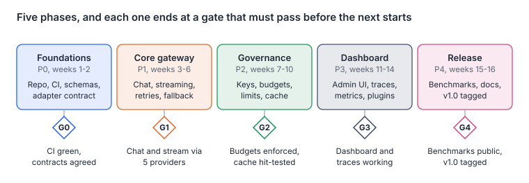

# Prism

**An OpenAI-compatible AI gateway.** Prism puts one endpoint in front of many LLM providers. It handles routing, failover, caching, governance and observability, so your applications don't have to.

> [!WARNING]
> Prism is in early development (pre-alpha, `0.1.0`). The foundations are in place: the core contracts, the configuration and the database schema. The gateway endpoints are not yet available, and APIs and configuration may change without notice. See the [roadmap](#roadmap).

## Why Prism

Teams that use several LLM providers often end up with provider SDKs scattered through their code, no shared view of spend, and features that go down whenever one provider does. Prism moves keys, routing, limits and monitoring into one gateway, so applications call a single stable endpoint and providers can change behind it.

- **One API.** Use the OpenAI and Anthropic SDKs you already have. Change the base URL, and switch models by changing a string.
- **Resilient by default.** Retries with exponential backoff and jitter, ordered fallback chains, and a circuit breaker for each target.
- **Cost and quota control.** Virtual keys, per-team budgets, RPM and TPM rate limits, and routing that knows how much free-tier quota each key has left.
- **Observable.** Prometheus metrics, OpenTelemetry traces, and a cost recorded for every request. Prompts are never logged by default.
- **Extensible.** Provider adapters, plugins and routing policies are small, well-defined contracts. New behaviour never touches the core.
- **Zero-config start.** One command with SQLite and in-memory limits. PostgreSQL and Redis are optional, for production.

## Planned features (v1)

| Area | Capabilities |
| --- | --- |
| API | `/v1/chat/completions` (streaming, tool calls, structured output), `/v1/embeddings`, `/v1/models`, `/v1/messages` (Anthropic format) |
| Providers | OpenAI, Anthropic, Gemini, Groq, Mistral, Cerebras, NVIDIA NIM, Cloudflare Workers AI, GitHub Models, Ollama, and any OpenAI-compatible server (vLLM, llama.cpp, LM Studio) |
| Routing | Priority, weighted, round-robin, latency-based, cost-based and quota-aware policies. Key pools with weights and daily quotas. |
| Governance | Hashed virtual keys, team budgets (soft or hard), token-bucket rate limits, audit log |
| Plugins | Exact and semantic response caching, guardrails, PII redaction, a plugin SDK for custom hooks |
| Operations | Admin API and web dashboard, Docker and Compose, Helm chart |

The full specification is in the [product requirements document](docs/PRD.md).

## Quickstart

**Requirements:** [uv](https://docs.astral.sh/uv/). uv installs Python 3.13 for you if it is not already present.

```bash
git clone <repository-url> prism
cd prism
uv sync
```

Copy the environment file and add your provider keys:

```bash
cp .env.example .env
```

Validate the example configuration, create the database, and start the server:

```bash
uv run prism check-config config/prism.example.yaml
uv run prism db-upgrade
uv run prism serve --config config/prism.example.yaml
```

Check that the gateway is ready:

```bash
curl http://127.0.0.1:8000/readyz
```

### Usage (once the gateway endpoints ship)

Point any OpenAI client at Prism and use a route name as the model:

```python
from openai import OpenAI

client = OpenAI(base_url="http://localhost:8000/v1", api_key="<prism-virtual-key>")

reply = client.chat.completions.create(
    model="fast-chat",  # a Prism route, not a provider model
    messages=[{"role": "user", "content": "Hello"}],
)
```

## Configuration

Prism reads providers and routes from a YAML file. Provider keys never appear in the file. Each key entry names an environment variable that holds the secret.

```yaml
providers:
  - id: groq
    kind: groq
    keys:
      - env: GROQ_KEY_1
        weight: 2
      - env: GROQ_KEY_2
        weight: 1

routes:
  - name: fast-chat        # clients send this as the model name
    policy: priority
    targets:               # tried in order on failure
      - provider: groq
        model: <model-id>
      - provider: gemini
        model: <model-id>
    retry:
      max_retries: 2
      backoff_ms: 200
    cache:
      exact: true
      ttl_s: 300
```

See [`config/prism.example.yaml`](config/prism.example.yaml) for a complete example.

### Environment variables

| Variable | Description | Default |
| --- | --- | --- |
| `PRISM_CONFIG` | Path to the YAML config file | none |
| `PRISM_DATABASE_URL` | SQLAlchemy database URL | `sqlite+aiosqlite:///./prism.db` |
| Provider keys | Any variable that the config file names, for example `GROQ_KEY_1` | none |

### CLI

| Command | Description |
| --- | --- |
| `prism serve [--config PATH] [--host HOST] [--port PORT]` | Start the gateway (default `127.0.0.1:8000`) |
| `prism check-config PATH [--require-env]` | Validate a config file. With `--require-env`, also fail if a referenced key variable is not set. |
| `prism db-upgrade [--url URL]` | Create or migrate the database schema |
| `prism --version` | Print the version |
| `prism --install-completion` | Install shell completion for the current shell |

Run `prism --help` or `prism <command> --help` for every option.

### Endpoints

| Endpoint | Status | Description |
| --- | --- | --- |
| `GET /healthz` | Available | Liveness check |
| `GET /readyz` | Available | Readiness check: version and loaded provider and route counts |
| `POST /v1/chat/completions` | Planned | OpenAI chat completions, with SSE streaming |
| `POST /v1/embeddings` | Planned | Embeddings |
| `GET /v1/models` | Planned | Routes the calling key may use |
| `POST /v1/messages` | Planned | Anthropic Messages format |
| `GET /metrics` | Planned | Prometheus metrics |
| `/admin/v1/*` | Planned | Admin API, with separate credentials |

## Architecture


Prism separates a **data plane** from a **control plane**. The data plane serves requests and keeps no state of its own. The control plane owns the configuration, the admin API and the dashboard. Workers keep an immutable snapshot of the configuration and swap it in atomically when it changes, so updates never need a restart.

Each request passes through five stages: authenticate, pre-process (plugins), route, call the provider, post-process. Every failure is classified. It is then retried, failed over to the next target, or returned to the client as a standard OpenAI error object.


Most of the logic sits behind three contracts:

| Contract | Location | Purpose |
| --- | --- | --- |
| `ProviderAdapter` | [`src/prism/providers/base.py`](src/prism/providers/base.py) | Translates requests, responses, streams and errors for one provider |
| `Plugin` | [`src/prism/plugins/base.py`](src/prism/plugins/base.py) | Runs hooks before and after each request |
| `RoutingPolicy` | [`src/prism/core/policies/base.py`](src/prism/core/policies/base.py) | Decides the order in which a route's targets are tried |

Design decisions are recorded as ADRs in [`docs/adr/`](docs/adr/).

## Roadmap



| Phase | Scope | Exit criteria | Status |
| --- | --- | --- | --- |
| 0. Foundations | Repository, CI, schemas, contracts | CI green, contracts agreed | In progress |
| 1. Core gateway | Chat, streaming, retries, fallback | Chat and streaming through 5 providers | Planned |
| 2. Governance | Virtual keys, budgets, rate limits, caching | Budgets enforced, cache verified | Planned |
| 3. Dashboard | Admin UI, traces, metrics, plugins | Dashboard and traces working | Planned |
| 4. Release | Benchmarks, documentation | Benchmarks published, v1.0 tagged | Planned |

Post-v1 work includes an MCP gateway, SSO and RBAC, multimodal input, cloud platform providers (Azure OpenAI, AWS Bedrock, Vertex AI) and evaluation-driven routing.

## Development

```bash
make sync        # install dependencies
make hooks       # install the Git hooks (once per clone)
make check       # lint, type check, test, and verify the Postman collection
make format      # auto-fix lint issues and format
make run         # start the server with the example config
make postman     # regenerate the Postman collection
```

The test suite has three layers:

- **Unit tests** (`tests/unit/`) run fast and do no I/O.
- **Contract tests** (`tests/contract/`) check that a provider adapter behaves correctly.
- **Integration tests** (`tests/integration/`) cover the database and the web app.

The suite fails if coverage drops below 85%. Pyright runs in strict mode on `core`, `providers` and `plugins`.

### Git hooks

`make hooks` points Git at the hooks in [`scripts/githooks/`](scripts/githooks/):

| Hook | Runs | Checks |
| --- | --- | --- |
| `pre-commit` | On every commit, on staged files only | Blocks `.env` files and private keys. Runs ruff lint and format checks. |
| `pre-push` | Before every push | The full CI gate: ruff, pyright, tests with coverage, and the Postman collection check |

To skip a hook once, add `--no-verify` to `git commit` or `git push`.

### Postman collection

`make postman` generates these files in [`docs/postman/`](docs/postman/) from the app's OpenAPI schema:

| File | Contents |
| --- | --- |
| `prism.postman_collection.json` | Every endpoint, grouped by tag, with example request bodies |
| `prism-local.postman_environment.json` | The **Prism (Local)** environment |

To use them:

1. In Postman, choose **Import** and select both files.
2. Select the **Prism (Local)** environment in the top-right corner.
3. Set `virtualKey` to your Prism virtual key. It's stored as a secret, so Postman masks it.

| Variable | Default | Purpose |
| --- | --- | --- |
| `baseUrl` | `http://127.0.0.1:8000` | Address of the gateway |
| `virtualKey` | empty | Bearer token sent with authenticated requests |

Don't put your key into the files before committing them. Set it only in Postman.

To add another environment, such as staging, add an entry to `ENVIRONMENTS` in [`scripts/generate_postman.py`](scripts/generate_postman.py) and run `make postman`.

After changing an endpoint, run `make postman` and commit the result. The pre-push hook and CI fail if any of these files are out of date.

### Adding a provider adapter

1. Create `src/prism/providers/<name>.py` with a class that implements `ProviderAdapter` (`chat`, `chat_stream`, `classify_error`).
2. Write a test harness that drives a simulated upstream. Use [`tests/contract/test_fake_adapter.py`](tests/contract/test_fake_adapter.py) as a reference.
3. Subclass `AdapterContractSuite` with your harness. The suite checks usage reporting, the shape of the stream, and how every kind of error is classified.

An adapter is complete when it passes the full contract suite.

### Project layout

```text
src/prism/
├── core/          request and response types, errors, request context, routing policies
├── providers/     adapter contract and the reference fake provider
├── plugins/       plugin contract
├── store/         database models, connection, Alembic migrations
├── config.py      configuration schema and loader
├── main.py        ASGI application
└── cli.py         the `prism` command
tests/
├── unit/
├── contract/
└── integration/
scripts/
├── githooks/              pre-commit and pre-push hooks
├── install-githooks.sh
└── generate_postman.py    builds the Postman collection from the OpenAPI schema
docs/
├── PRD.md         product requirements
├── adr/           architecture decision records
├── postman/       generated Postman collection
└── diagrams/
```

## Contributing

Contributions are welcome. Before opening a pull request:

1. Open an issue to discuss significant changes.
2. Make sure `make check` passes.
3. For a design change, add or update an ADR in `docs/adr/`.

## License

The license has not been chosen yet; Apache-2.0 and MIT are under consideration. Until a `LICENSE` file is added, all rights are reserved.
