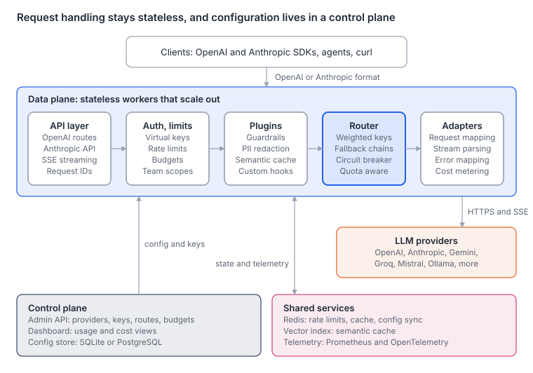
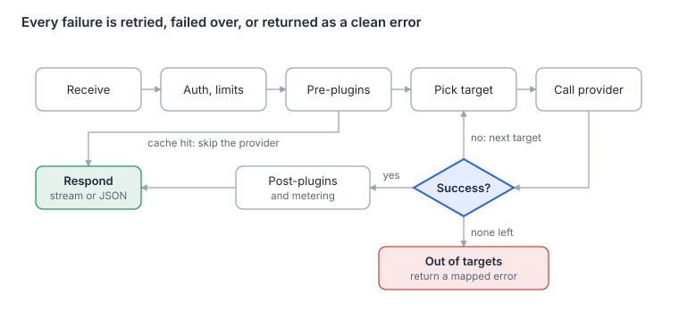
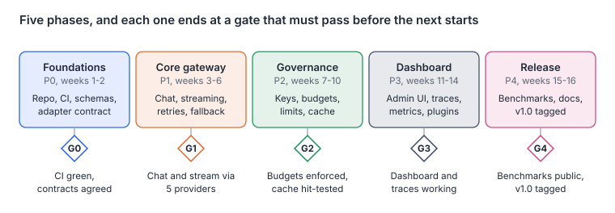

# Prism: Product Requirements Document

Nov 18, 2026 · Sumit Kumar

Prism is an OpenAI-compatible AI gateway: one endpoint for many LLM providers, with routing, failover, caching, governance and tracing built in.

## Summary

| Field | Value |
| --- | --- |
| Product | Prism, an open-source AI gateway |
| Version | 0.1, draft for review |
| Owner | Sumit |
| Repository | /Users/macbook/Coding/Projects/Prism (empty, greenfield) |
| Language | Python 3.13 |
| License | Apache-2.0 (proposed) |
| Scope of v1 | Gateway, routing, governance, observability, admin dashboard. No hosted SaaS. |

Read this first:

- Prism starts from scratch in an empty repository.
- Every performance number here is a proposed target, to be validated by the Phase 1 benchmarks.
- Section 15 lists the open questions that need an answer before Phase 1 starts.

## 1. Objective

Prism gives teams one reliable, governed endpoint for all their LLM traffic.

### Problem

Teams that call several LLM providers end up with provider SDKs spread through application code, no shared view of cost, and outages that take features down. A gateway centralises keys, routing, limits and monitoring, so applications talk to one stable endpoint and providers can change behind it.

### Vision

Every LLM call in an organisation goes through Prism, and nobody notices when a provider fails.

### Goals

1. One OpenAI-compatible endpoint for 10 providers at v1: OpenAI, Anthropic, Gemini, Groq, Mistral, Cerebras, NVIDIA NIM, Cloudflare Workers AI, GitHub Models and Ollama.
2. Survive provider failures through retries, fallback chains and circuit breakers.
3. Control cost and quota with virtual keys, budgets, rate limits and free-tier quota awareness.
4. Be observable by default: Prometheus metrics, OpenTelemetry traces and per-request cost.
5. Stay extensible through plugins and provider adapters, so new behaviour never touches the core.
6. Start with zero configuration: one command, SQLite and in-memory limits, first request in under five minutes.

### Non-goals for v1

- Chasing record throughput. Prism targets low, predictable overhead.
- A hosted SaaS or multi-tenant billing.
- Hosting or serving models. Prism routes to inference servers and never runs one.
- Prompt management, evaluation platforms or fine-tuning.
- Multi-region clustering and active-active deployments.

### Target users

| Persona | Need | What Prism offers |
| --- | --- | --- |
| Application developer | One URL, switch models by changing a string | OpenAI and Anthropic compatible routes |
| Platform or ML engineer | Keys, budgets, failover and metrics in one place | Virtual keys, routing policies, dashboards |
| Indie developer or student | Combine free tiers across providers | Quota-aware routing across free-tier keys |
| Self-hosting operator | Run the gateway on their own infrastructure with little setup | One container, optional PostgreSQL and Redis |

### Success metrics (proposed targets)

| Metric | Target | How measured |
| --- | --- | --- |
| Time to first request | Under 5 minutes from clone | Quickstart test in CI |
| Gateway overhead, non-streaming | p50 under 3 ms, p99 under 10 ms at 1,000 RPS on 4 vCPU | Load test against a mock upstream |
| Streaming first-token overhead | Under 5 ms at p95 | Same load test |
| Failover | At least 99% of requests succeed during a primary outage when a healthy fallback exists | Chaos test |
| Provider coverage | 10 providers passing adapter contract tests | CI |
| Core test coverage | At least 85% | Coverage report in CI |

## 2. Tech Stack

Prism uses a mainstream async stack, and PostgreSQL and Redis stay optional for single-node installs.

| Layer | Choice | Why |
| --- | --- | --- |
| Language | Python 3.13 (3.14 once dependencies support it) | Mature async ecosystem and modern typing |
| Packaging | uv with pyproject.toml and a lockfile | Fast, reproducible installs |
| Web framework | FastAPI on Starlette | Async, typed routes, OpenAPI docs for free |
| ASGI server | Uvicorn with uvloop, multiple worker processes | Mature and simple. Granian is the benchmark alternative. |
| Upstream HTTP client | httpx AsyncClient with HTTP/2 and pooled connections | One pooled client per provider. Revisit aiohttp if benchmarks show client overhead. |
| Validation and JSON | Pydantic v2 and orjson | Fast validation and serialisation |
| Primary store | SQLite by default, PostgreSQL 16+ in production, through SQLAlchemy 2 async and Alembic | Zero-config start, durable at scale |
| Cache and limits | In-process by default, Redis for multi-node | Shared rate limits, cache and config sync |
| Semantic cache | ONNX Runtime embeddings (BGE-small) with pgvector | CPU only, no extra service in Postgres installs |
| Observability | OpenTelemetry SDK, prometheus-client, structlog | Vendor-neutral traces, metrics, JSON logs |
| MCP | Official MCP Python SDK | Tool aggregation behind the gateway |
| Auth | Hashed virtual API keys. OIDC in v2. | Simple first, enterprise later |
| Dashboard | Next.js (App Router), shadcn/ui, Tailwind, SWR, Recharts | Component-driven UI with simple data fetching and charts |
| Code quality | ruff, pyright, pytest, pytest-asyncio, respx, hypothesis | Fast lint, strict types, deterministic upstream mocks |
| Load testing | Locust and k6 against a mock upstream | Repeatable overhead measurements |
| Delivery | Docker (multi-stage), Docker Compose, Helm chart, GitHub Actions | One image for every environment |

Versions are pinned from PyPI when the repository is created. None are fixed in this document.

## 3. Architecture Overview

Prism splits a stateless data plane that serves requests from a control plane that owns configuration, so workers scale out freely and config changes never need a restart.



Clients call the data plane, which reads its configuration from the control plane's store and keeps shared state only in shared services.

| Component | Plane | Responsibility |
| --- | --- | --- |
| API layer | Data | OpenAI and Anthropic compatible routes, SSE streaming, request IDs |
| Auth and limits | Data | Virtual key lookup, rate limits, budget checks, team scopes |
| Plugin pipeline | Data | Pre and post hooks: guardrails, PII redaction, semantic cache, custom code |
| Router | Data | Picks a target by policy, with retries, fallback chains and circuit breakers |
| Provider adapters | Data | Translate requests, responses, streams and errors for each provider |
| Usage meter | Data | Counts tokens, prices each request, emits events off the hot path |
| Admin API | Control | Create and edit providers, keys, routes, budgets and plugins |
| Dashboard | Control | Usage, cost and health views over the admin API |
| Config store | Control | Source of truth, cached in every worker and refreshed on change |
| Shared services | Shared | Redis, vector index, telemetry backends |

Design principles:

- Workers are stateless, so any worker can serve any request.
- Configuration is data in the store, never code or environment edits.
- Adapters absorb every provider quirk, so the core speaks one internal format.
- Authentication fails closed. Cache and plugins fail open unless a policy says otherwise.

## 4. High-Level Design

A request passes through five stages: authenticate, pre-process, route, call the provider, post-process. Every failure is classified, then retried, failed over or returned as a clean error.



A cache hit skips the provider. A failed call returns to the router, which tries the next target until none are left.

### Routing and resilience

- A route maps a public model name, such as `fast-chat`, to an ordered list of targets. Each target is a provider, a model and a pool of keys.
- Routing policies in v1: priority, weighted, round robin, latency-based, cost-based and quota-aware (for free tiers). Evaluation-driven routing comes in v2.
- Errors are classified as retryable (429, 5xx, timeout), non-retryable (400, 401, content policy) or misconfiguration.
- A retryable error is retried on the same target with exponential backoff and jitter, at most twice, then moves to the next target.
- Each target has a circuit breaker. It opens after consecutive failures and sends a probe request after a cooldown.

### Streaming

- Server-sent events pass through chunk by chunk. The adapter converts each provider chunk to the OpenAI delta format on the fly.
- Fallback is only allowed before the first token. After that, a failure ends the stream with an error event and records partial usage.
- A client disconnect cancels the upstream call. Each request has a bounded buffer so a slow client cannot grow memory.

### Caching

- Exact cache: a hash of the normalised request (model, messages, parameters) maps to a stored response with a TTL.
- Semantic cache: the last user message is embedded and matched by nearest neighbour above a similarity threshold, scoped to one route and one team. It is opt-in per route.
- Requests with tool calls or high temperature are not cached unless the route allows it.

### Governance

- A virtual key is a hashed secret tied to a team, a budget, rate limits and a list of allowed routes.
- Budgets are checked against an estimate before the call and settled with real usage after it. Limits are soft or hard and reset daily, weekly or monthly.
- Rate limits use a token bucket per key, for requests per minute and tokens per minute.

### MCP gateway (v2)

- MCP servers are registered once and exposed through one governed `/mcp` endpoint with per-key tool allow lists.
- Tool calls are traced and metered like model calls.

### Configuration propagation

- The admin API writes to the store and publishes a change event. Redis pub/sub is used in multi-node setups and short polling in single-node ones.
- Each worker rebuilds an immutable config snapshot and swaps it in atomically, so in-flight requests never see half-applied changes.

### Deployment topologies

| Topology | Components | Use |
| --- | --- | --- |
| Single node | One container, SQLite, in-memory limits | Local development, small teams |
| Scaled | Several gateway workers, PostgreSQL, Redis, dashboard | Production |
| Kubernetes | Helm chart, autoscaling on CPU and request rate, external Postgres and Redis | Platform teams |

## 5. Low-Level Design

Three small contracts (provider adapter, plugin, routing policy) carry almost all of Prism's logic, so new providers and behaviours never touch the core.

### Repository layout

```text
Prism/
├── pyproject.toml
├── src/prism/
│   ├── main.py              # app factory and startup
│   ├── api/
│   │   ├── openai.py        # /v1/chat/completions, /v1/embeddings, /v1/models
│   │   ├── anthropic.py     # /v1/messages
│   │   └── admin.py         # admin API
│   ├── core/
│   │   ├── types.py         # internal request, response and chunk types
│   │   ├── pipeline.py      # runs a request through every stage
│   │   ├── router.py        # builds the ordered target list
│   │   ├── policies/        # priority, weighted, latency, cost, quota
│   │   ├── resilience.py    # retries, backoff, circuit breaker
│   │   └── errors.py        # error kinds and mapping
│   ├── providers/           # one adapter per provider
│   ├── plugins/             # guardrails, pii, cache
│   ├── governance/          # keys, budgets, rate limits
│   ├── store/               # database, migrations, config snapshot
│   ├── telemetry/           # metrics, tracing, logging
│   └── mcp/                 # MCP gateway (v2)
├── dashboard/               # Next.js admin UI
├── tests/                   # unit, contract, integration, load
├── deploy/                  # Dockerfile, compose.yaml, Helm chart
└── docs/
```

### Core contracts

```python
class ProviderAdapter(Protocol):
    name: str

    async def chat(self, req: ChatRequest, target: Target) -> ChatResponse:
        """Send one request and return the full answer."""

    def chat_stream(self, req: ChatRequest, target: Target) -> AsyncIterator[ChatChunk]:
        """Send one request and yield answer pieces as they arrive."""

    def classify_error(self, exc: Exception) -> ErrorKind:
        """Turn a provider error into one of Prism's error kinds."""


class Plugin(Protocol):
    async def before_request(self, ctx: RequestContext) -> Decision:
        """Return Continue, ShortCircuit(response) or Reject(error)."""

    async def after_response(self, ctx: RequestContext, resp: ChatResponse) -> None:
        """Run after the answer is ready. Used for logging and cache writes."""


class RoutingPolicy(Protocol):
    def order(self, targets: list[Target], ctx: RequestContext) -> list[Target]:
        """Return the targets in the order they should be tried."""
```

### Data model

| Table | Key columns | Notes |
| --- | --- | --- |
| `providers` | `id`, `kind`, `base_url`, `enabled` | One row per upstream provider |
| `provider_keys` | `id`, `provider_id`, `secret_encrypted`, `weight`, `daily_quota`, `status` | Secrets encrypted at rest |
| `routes` | `id`, `name`, `policy`, `config_json` | The public model name clients call |
| `route_targets` | `route_id`, `position`, `provider_id`, `model`, `key_pool` | Ordered fallback chain |
| `teams` | `id`, `name` | Owner of keys and budgets |
| `virtual_keys` | `id`, `key_hash`, `team_id`, `allowed_routes`, `rpm`, `tpm`, `expires_at` | Only the hash is stored |
| `budgets` | `id`, `scope`, `limit_usd`, `period`, `reset_at`, `spent_usd` | Scope is a key or a team |
| `usage_events` | `id`, `ts`, `request_id`, `key_id`, `route`, `provider`, `model`, `input_tokens`, `output_tokens`, `cost_usd`, `latency_ms`, `status`, `cache_hit` | Partitioned by day on PostgreSQL |
| `plugin_configs` | `id`, `scope`, `plugin`, `position`, `config_json` | Order decides execution |
| `audit_log` | `id`, `ts`, `actor`, `action`, `target` | Every admin change |

### Key algorithms

- **Key selection:** weighted random choice among keys that are healthy and still have quota left today.
- **Retry delay:** `min(2 s, 0.2 s × 2^attempt)` with random jitter of 50 to 100 percent, at most two retries per target.
- **Circuit breaker:** closed, open and half-open states. Proposed defaults: open after 5 consecutive failures, wait 30 seconds, then allow one probe request.
- **Rate limit:** a token bucket per key. Multi-node installs run it as an atomic Lua script in Redis.
- **Cost:** a price table per model (per million tokens) held in the store and editable through the admin API. Budgets use an estimate before the call and real usage after.
- **Usage events:** written to an in-memory queue and flushed in batches, so the database never sits on the request path.

### Error taxonomy

| Kind | Examples | Action | Client sees |
| --- | --- | --- | --- |
| `rate_limited` | Provider 429 | Retry, then next target | 429 with Retry-After when all targets are exhausted |
| `upstream_unavailable` | 5xx, timeout, connection error | Retry, then next target | 502 or 504 |
| `invalid_request` | 400, 422 | No retry | 400 with the provider message |
| `auth_failed` | 401 or 403 on a provider key | Disable the key, try the next target, raise an alert | 502 with a generic message |
| `content_blocked` | Provider safety filter | No retry, optional route fallback | 400 with code `content_policy` |
| `budget_exceeded` | Prism budget reached | Reject before the call | 429 with code `budget_exceeded` |
| `internal_error` | Bug in Prism | No retry | 500 |

### Config schema (example values)

```yaml
providers:
  - id: groq
    kind: openai_compatible
    base_url: https://api.groq.com/openai/v1
    keys:
      - env: GROQ_KEY_1
        weight: 2
      - env: GROQ_KEY_2
        weight: 1

routes:
  - name: fast-chat
    policy: priority
    targets:
      - provider: groq
        model: <model-id>
      - provider: gemini
        model: <model-id>
    retry:
      max_attempts: 2
      backoff_ms: 200
    cache:
      exact: true
      ttl_s: 300
```

## 6. Features Supported

Prism has 26 planned features: 21 in v1 and 5 in v2.

| Area | Feature | What it does | Release |
| --- | --- | --- | --- |
| API | OpenAI chat completions | `/v1/chat/completions` with streaming, tool calls and structured output | v1 |
| API | Models and embeddings | `/v1/models` and `/v1/embeddings` | v1 |
| API | Anthropic Messages route | `/v1/messages` as a drop-in for the Anthropic SDK | v1 |
| API | Multimodal input | Image and audio passthrough | v2 |
| Providers | Core five | OpenAI, Anthropic, Gemini, Groq, Mistral | v1 |
| Providers | OpenAI-compatible endpoints | vLLM, llama.cpp, LM Studio or any compatible server | v1 |
| Providers | Free-tier set | Cerebras, NVIDIA NIM, Cloudflare Workers AI, GitHub Models, Ollama | v1 |
| Providers | Cloud platforms | Azure OpenAI, AWS Bedrock, Vertex AI | v2 |
| Routing | Priority and weighted routes | Ordered or weighted target lists | v1 |
| Routing | Retries, fallbacks, circuit breakers | Automatic recovery from provider failures | v1 |
| Routing | Key pools | Several keys per provider with weights and daily quotas | v1 |
| Routing | Smart policies | Latency-, cost- and quota-aware routing | v1 |
| Routing | Evaluation-driven routing | Pick targets by measured answer quality | v2 |
| Governance | Virtual keys | Hashed keys tied to teams and allowed routes | v1 |
| Governance | Rate limits and budgets | RPM, TPM and spend limits with reset periods | v1 |
| Governance | SSO and RBAC | OIDC login and role-based admin access | v2 |
| Plugins | Response caching | Exact cache and an opt-in semantic cache | v1 |
| Plugins | Guardrails and PII | Keyword filters and PII redaction | v1 |
| Plugins | Plugin SDK | Write custom hooks that run before and after each request | v1 |
| MCP | MCP gateway | Governed tool access per key | v2 |
| Observability | Metrics and logs | Prometheus metrics and structured JSON logs | v1 |
| Observability | Traces and cost | OpenTelemetry spans, per-request cost, usage events | v1 |
| Control plane | YAML config | File-based setup for single-node use | v1 |
| Control plane | Admin API and dashboard | Manage and monitor from a web UI | v1 |
| Delivery | Docker and Compose | One image, one command to start | v1 |
| Delivery | Helm chart | Kubernetes deployment | v1 |

## 7. API Surface and Compatibility

Prism uses the OpenAI API shape as its native format and adds an Anthropic route and an admin API, so existing SDKs work by changing only the base URL.

| Endpoint | Purpose |
| --- | --- |
| `POST /v1/chat/completions` | Chat, with streaming over server-sent events |
| `POST /v1/embeddings` | Embeddings |
| `GET /v1/models` | Route names the calling key may use |
| `POST /v1/messages` | Anthropic Messages format |
| `GET /healthz` and `GET /readyz` | Liveness and readiness |
| `GET /metrics` | Prometheus metrics |
| `/admin/v1/*` | Providers, keys, routes, virtual keys, budgets, usage, plugins, audit log. Separate admin credentials. |

Drop-in use with the OpenAI SDK:

```python
from openai import OpenAI

# Only the address and the key change. The rest of the code stays the same.
client = OpenAI(base_url="http://localhost:8000/v1", api_key="prism-virtual-key")
reply = client.chat.completions.create(
    model="fast-chat",  # a Prism route name
    messages=[{"role": "user", "content": "Hello"}],
)
```

Compatibility rules:

- Unknown parameters pass straight through to OpenAI-compatible providers. For other providers the adapter maps or drops them and sets an `x-prism-warning` header.
- Every response carries `x-prism-request-id`, `x-prism-provider`, `x-prism-model` and `x-prism-cache` (hit or miss).
- Errors use the OpenAI error object: `message`, `type`, `code`.
- `/v1` stays stable. A breaking change ships under `/v2`.

## 8. Non-Functional Requirements

Prism aims for single-digit-millisecond overhead and stays up when its own dependencies fail. All numbers are proposed targets to confirm in Phase 1.

| Area | Requirement |
| --- | --- |
| Overhead | Non-streaming p50 under 3 ms and p99 under 10 ms at 1,000 RPS on 4 vCPU. Streaming first-token overhead under 5 ms at p95. |
| Throughput | At least 1,000 sustained RPS per 4 vCPU instance against a mock upstream, scaling close to linearly across workers |
| Memory | Under 512 MB per worker at 500 concurrent streams |
| Startup | Ready in under 3 seconds. A config reload completes in under 100 ms. |
| Redis down | Fall back to in-process rate limits and skip the cache. Requests keep flowing. |
| Database down | Keep serving from the last config snapshot (fail static). Buffer usage events up to 10,000, then drop the oldest and count the drops in a metric. |
| Usage durability | Events flush in batches every 5 seconds. Loss is possible only on a hard crash. |
| Scalability | Stateless workers scale horizontally. The database sees only batched writes. |
| Portability | Python 3.13 or newer, Linux and macOS, amd64 and arm64 container images |
| Maintainability | Strict type checking on core modules, at least 85% test coverage, a written decision record for each major design choice |

## 9. Security and Compliance

Prism holds every provider credential an organisation owns, so it treats key handling, auditability and cost abuse as first-class design problems.

- Provider keys are encrypted at rest with AES-GCM, using a master key from the environment or a KMS. They never appear in logs and are masked in the UI.
- Virtual keys are shown once at creation. Only a salted hash is stored, plus a short prefix for identification.
- The admin API uses separate credentials, can listen on a separate port, and writes every change to the audit log.
- Prompt and response logging is off by default. Routes can opt in, with PII redaction and a retention period.
- Request size limits and timeouts apply everywhere. Custom `base_url` values that point to private network ranges are refused unless an operator allows them.
- TLS ends at the ingress or reverse proxy. Prism verifies certificates on every upstream call.

| Threat | Mitigation |
| --- | --- |
| Stolen virtual key | Expiry, per-key rate limit and budget, instant revocation |
| Leaked provider key | Encryption at rest, no logging, rotation support, auto-disable on repeated 401 |
| Runaway cost | Hard budgets, rate limits, an alert at 80% of budget |
| SSRF through a custom endpoint | Private ranges denied by default |
| Prompt injection through tools | Per-key MCP tool allow lists and argument guardrails (v2) |
| Supply chain | Pinned lockfile, `pip-audit` in CI, SBOM, signed container images |

Compliance posture: Prism gives operators the controls they need for GDPR or SOC 2 work (audit log, retention settings, no content logging by default). The project itself is not certified.

## 10. Observability

Every request is measurable from day one: metrics for dashboards and alerts, traces for debugging, and structured logs that never contain prompts by default.

| Metric | Type | Labels |
| --- | --- | --- |
| `prism_requests_total` | Counter | route, provider, model, status |
| `prism_request_duration_seconds` | Histogram | route, provider |
| `prism_gateway_overhead_seconds` | Histogram | route |
| `prism_upstream_errors_total` | Counter | provider, kind |
| `prism_fallbacks_total` | Counter | route, from_provider, to_provider |
| `prism_circuit_state` | Gauge | provider, model |
| `prism_tokens_total` | Counter | route, model, direction |
| `prism_cost_usd_total` | Counter | team, route |
| `prism_cache_hits_total` | Counter | route, type |
| `prism_key_quota_remaining` | Gauge | provider, key_id |

- **Traces:** one span per stage (auth, plugins, routing, upstream call) with OpenTelemetry GenAI attributes for model and token usage. The W3C `traceparent` header is accepted and forwarded.
- **Logs:** JSON lines with the request ID, route, provider, status and latency. No prompt or response text unless a route opts in.
- **Dashboards:** a Grafana JSON bundle ships with Prism, and the built-in dashboard shows usage, cost by team, provider health, fallback rate, latency and cache hit ratio.
- **Alerts:** sample Prometheus rules for error rate, fallback spikes, a circuit open for more than 5 minutes, and budgets at 80%.

## 11. Testing and Benchmarking Strategy

Prism earns trust with repeatable tests at every layer and a public benchmark anyone can reproduce.

| Layer | What it checks | Tools |
| --- | --- | --- |
| Unit | Routing policies, retry delays, circuit breaker states, cost maths | pytest, hypothesis |
| Adapter contract | Each adapter against recorded fixtures: request mapping, streaming, error classification | pytest, respx |
| Integration | The full gateway with a fake upstream, on SQLite and on PostgreSQL plus Redis | pytest-asyncio, testcontainers |
| Load | Overhead and throughput against a mock upstream with fixed latency | Locust, k6 |
| Chaos | Upstream 5xx, timeouts, slow streams, mid-stream disconnects | Fault-injecting mock upstream |
| Security | Dependency audit, secret scanning, static analysis | pip-audit, ruff, CI scanners |
| Regression | Overhead tracked per commit, CI fails on a regression above 15% | pytest-benchmark |

Published benchmark: share the load-test method, the scripts and the raw results, so anyone can reproduce the overhead numbers.

## 12. Deployment and Operations

One container image runs everywhere: a single command for local use, Compose for small teams, and a Helm chart for Kubernetes.

- **Docker:** multi-stage build, non-root user. `docker run -p 8000:8000 prism` starts with SQLite and in-memory limits.
- **Compose:** gateway, PostgreSQL, Redis and dashboard in one file.
- **Helm:** values for replicas, autoscaling, secrets and ingress.
- **Configuration:** environment variables for secrets and bootstrap, a YAML file for declarative setup, the admin API for live changes.
- **Migrations:** Alembic runs on startup for single-node installs and as a separate job for scaled ones.
- **Upgrades:** rolling. A new version must read the config snapshot written by the previous one.

| Symptom | First check | Action |
| --- | --- | --- |
| High latency | `prism_gateway_overhead_seconds` against provider latency | If overhead is high, profile and add workers. If the provider is slow, change route policy. |
| Many 502 responses | `prism_upstream_errors_total` by provider and kind | Check circuit states and key status. Add a fallback target. |
| Budget not enforced | Virtual key to team to budget links | Check the budget scope and reset time |
| Rate limits uneven across nodes | Redis connectivity | Restore Redis. Limits are per node while it is down. |
| Config change not applied | Config snapshot version in `/readyz` | Check pub/sub or polling, then restart the worker |

## 13. Roadmap and Milestones

Prism v1 ships in five phases over about 16 weeks, and each phase ends at a gate that must pass before the next one starts.



Phases 0 and 1 produce a working gateway. Governance, the dashboard and the release follow, each behind its own gate.

Week counts are estimates. They assume one developer and shift with team size. The v2 items in section 6 are planned after the v1.0 release.

## 14. Risks and Mitigations

The biggest risks are gateway overhead, provider API drift and credential security, and each has a test or control planned in the first phases.

| Risk | Impact | Mitigation | Severity |
| --- | --- | --- | --- |
| Gateway overhead misses the targets under load | Adds latency to every request | Benchmark in Phase 1, profile early, use uvloop and orjson, run multiple workers, try Granian | High |
| Provider APIs change and break adapters | Silent failures in production | Contract tests with recorded fixtures, a nightly canary call per provider, versioned adapters | High |
| Scope creep in provider coverage | Late delivery | Cap v1 at 10 providers. The OpenAI-compatible adapter covers many more. | Medium |
| Streaming edge cases: mid-stream errors, partial usage | Billing and user-experience bugs | Explicit stream state machine, chaos tests | Medium |
| Free-tier quota rules change | Routing sends traffic to exhausted keys | Quotas live in config, not code. Read remaining quota from response headers where providers offer it. | Medium |
| Stored provider keys are stolen | Direct financial and trust damage | Encryption at rest, no logging, least-privilege admin, rotation | High |
| Slow adoption | Few users or contributors | Focus on a clear niche (free-tier routing and quota awareness), publish benchmarks and clear docs | Medium |
| Limited maintainer time | Delays | A strict v1 scope, automated CI, v2 deferred | Medium |

## 15. Open Questions and Assumptions

Seven decisions need an answer before Phase 1 starts, and the first one shapes how much effort goes into docs and benchmarks.

### Open questions

- [ ] Is Prism a learning and portfolio project, an open-source product, or both?
- [ ] Which two providers come first? Groq and Gemini are the natural free-tier pair.
- [ ] SQLite and PostgreSQL both in v1, or PostgreSQL only?
- [ ] Does the dashboard ship in v1.0, or follow in v1.1 once the API is stable? This draft ships it in v1.0.
- [ ] Is the name Prism free to use? It is a common name, so check PyPI, GitHub and trademarks before publishing.
- [ ] License: Apache-2.0 or MIT?
- [ ] Contributions: a CLA or a DCO sign-off?

### Assumptions

- One developer builds v1, working steadily.
- Prism is self-hosted only. There is no managed offering in v1.
- Provider free tiers and prices change, so they are configuration and never hard-coded.
- Operators have Docker available. Redis and PostgreSQL are optional.
- OpenAI's chat completions format is the internal standard that adapters translate to and from.

## Appendix: Glossary

| Term | Meaning |
| --- | --- |
| Gateway | A proxy that gives applications one endpoint for many LLM providers |
| Data plane | The part that serves requests. Stateless and scalable. |
| Control plane | The part that manages configuration: admin API, dashboard, store |
| Route | A public model name, such as `fast-chat`, mapped to an ordered list of targets |
| Target | One provider, model and key pool a route can send traffic to |
| Adapter | Code that translates between Prism's format and one provider's API |
| Virtual key | A Prism-issued key with its own budget, limits and allowed routes |
| Fallback chain | The ordered targets tried when an earlier target fails |
| Circuit breaker | A guard that stops sending traffic to a failing target until it recovers |
| Semantic cache | A cache that matches requests by meaning, not exact text |
| SSE | Server-sent events, the streaming format used by chat APIs |
| MCP | Model Context Protocol, a standard for giving models access to tools |
| RPM, TPM | Requests per minute, tokens per minute |
| OTel | OpenTelemetry, the standard for traces and metrics |
